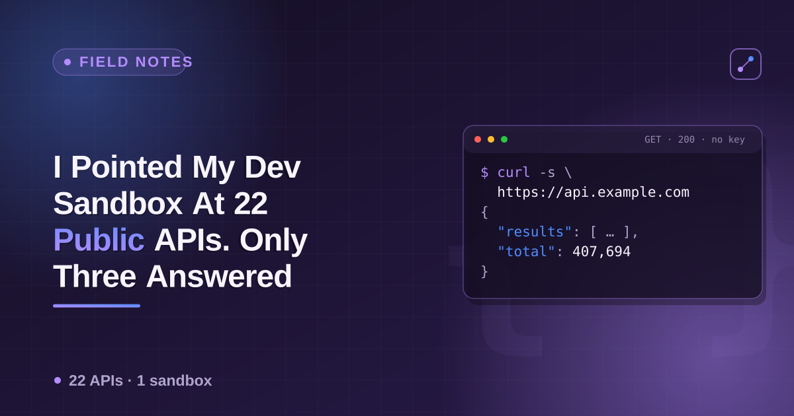

# GitHub REST Search API — a cheatsheet



GitHub's search API is free, well-documented, and covers repositories, users, issues/PRs and code in one consistent shape. The part people miss is the **rate-limit story**: search has its own, much tighter limit than the rest of the API, and it changes hard depending on whether you're authenticated — the gap is bigger than most other public APIs.

## Endpoints

| What | Endpoint | Auth |
|---|---|---|
| Search repositories | `GET https://api.github.com/search/repositories?q={query}` | optional |
| Search users | `GET https://api.github.com/search/users?q={query}` | optional |
| Search issues/PRs | `GET https://api.github.com/search/issues?q={query}` | optional |
| Search code | `GET https://api.github.com/search/code?q={query}` | **required** |
| Repo detail | `GET https://api.github.com/repos/{owner}/{repo}` | optional |
| User detail | `GET https://api.github.com/users/{login}` | optional |

All search endpoints take `sort`, `order` (`asc`/`desc`), `per_page` (max 100) and `page`. Every search response has the same envelope: `{ total_count, incomplete_results, items: [] }`.

```bash
curl -s "https://api.github.com/search/repositories?q=stars:%3E50000+language:rust&sort=stars&per_page=5" \
  -H "Accept: application/vnd.github+json" \
  | python3 -c "import json,sys; [print(r['full_name'], r['stargazers_count']) for r in json.load(sys.stdin)['items']]"
```

## Query syntax (the qualifiers that do the real work)

| Qualifier | Applies to | Example |
|---|---|---|
| `stars:>N` / `stars:N..M` | repos | `stars:>10000` |
| `language:X` | repos, code | `language:typescript` |
| `pushed:<DATE` / `pushed:>DATE` | repos | `pushed:<2024-01-01` — last-commit cutoff |
| `archived:true` / `archived:false` | repos | explicit archive status |
| `location:X` | users | `location:berlin` |
| `followers:>N` | users | `followers:>500` |
| `is:open` / `is:closed` | issues | `is:open is:pr` |
| `repo:owner/name` | issues, code | scope to one repo |
| `in:file`, `extension:X` | code | `extension:yml in:file` |

Dates use `YYYY-MM-DD`. Combine qualifiers with spaces (implicit AND); GitHub does not support OR across most qualifiers in one query.

## Rate limits (the part that bites)

| Access | Search API | Core API (repo/user detail) |
|---|---|---|
| Unauthenticated | **10 requests/minute** | 60 requests/hour |
| Personal access token (PAT) | 30 requests/minute (code search stays at 10/min even authenticated) | 5,000 requests/hour |

Check your current standing anytime, keyless:

```bash
curl -s https://api.github.com/rate_limit -H "Accept: application/vnd.github+json"
```

A read-only PAT (`public_repo` scope is enough — no write access needed) is a two-minute setup and takes search from "a handful of queries before you're throttled" to genuinely usable. Send it as `Authorization: Bearer {token}`.

## Pagination cap

Search results are capped at **1,000 total**, regardless of `per_page`/`page` — GitHub simply won't paginate past it. If a query returns more, narrow it (add a qualifier, split by date range or language) rather than trying to page deeper.

## Notes

- `incomplete_results: true` in the response means GitHub's search timed out internally on that request — the count is provisional. Retry rather than trusting it.
- Search endpoints use their own limiter, separate from the "core" REST limiter (repo/user detail lookups). Hitting one doesn't affect the other.
- Search code (`/search/code`) is the one endpoint that requires auth even for a single request — no keyless path exists for it.

## Related

- **npm, PyPI & crates.io cheatsheet** — [noble-ronin/package-registry-apis](https://github.com/noble-ronin/package-registry-apis) — same "free, keyless-ish JSON API" pattern for package registries.

---

Running one query by hand with curl is easy. Running hundreds — pulling stars/forks/topics/license across thousands of repos, or tracking issues across a whole ecosystem — is what the [GitHub Search Scraper](https://apify.com/ponderable_hydrometer/github-search-scraper) actor on Apify does: normalized rows, rate-limit backoff built in, BYO token for the 5,000/h tier.

📄 The story that led here — 22 public APIs, one locked-down sandbox, and the one that answered with the most specific "no" of all: **[I Pointed My Dev Sandbox At 22 Public APIs. Only Three Answered Cleanly.](https://dev.to/ronin13/i-pointed-my-dev-sandbox-at-22-public-apis-only-three-answered-cleanly)**
